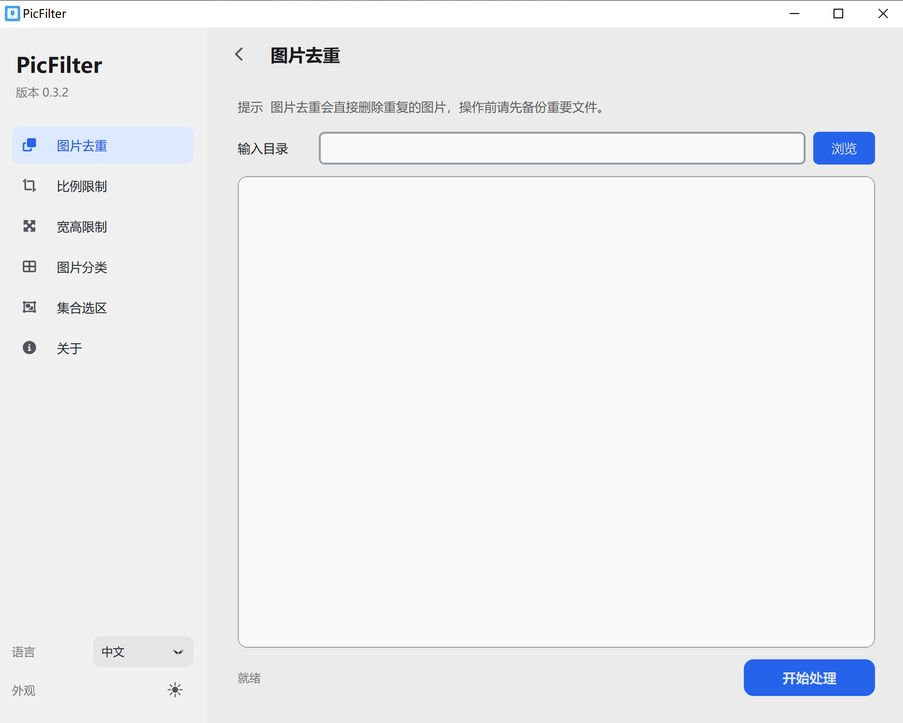

<p align="center">
  
</p>

<p align="center">PicFilter is a simple image processing tool built with Pillow, designed for batch filtering large image collections.</p>

<p align="center">
  <a href="README.md">简体中文</a> | <strong>English</strong>
</p>





# Features
* Image deduplication
* Aspect ratio filtering
* Width/height filtering
* Classify images as landscape, portrait, or square
* Set selection and comparison between two image groups

# Notes
* Deduplication does not yet detect identical images with different dimensions.
* Images that pass filtering are copied to the matching output directory.
* Source files are not deleted after filtering (except during deduplication).

# Build and Release

```bash
pip install -r requirements.txt
python App.py
```

The version number is stored in `package.json` and read at startup.

Pushing a tag in the `v<major>.<minor>.<patch>` format triggers GitHub Actions: it synchronizes the version, builds installers and portable packages for Windows, Linux, and macOS, generates release notes from the commits between the previous and current tags, and publishes them to GitHub Releases automatically.

| Platform            | Installer                            | Portable                                 |
| ------------------- | ------------------------------------ | ---------------------------------------- |
| Windows x64         | `PicFilter-v*-windows-x64-setup.exe` | `PicFilter-v*-windows-x64-portable.zip`  |
| Linux x64           | `PicFilter-v*-linux-x64.deb`         | `PicFilter-v*-linux-x64-portable.tar.gz` |
| macOS Apple Silicon | `PicFilter-v*-macos-arm64.dmg`       | `PicFilter-v*-macos-arm64-portable.zip`  |
| macOS Intel         | `PicFilter-v*-macos-x64.dmg`         | `PicFilter-v*-macos-x64-portable.zip`    |

The macOS installers are unsigned. On first launch, right-click and choose "Open", or run `xattr -dr com.apple.quarantine /Applications/PicFilter.app` before launching.

```bash
git tag v0.3.2
git push origin v0.3.2
```
