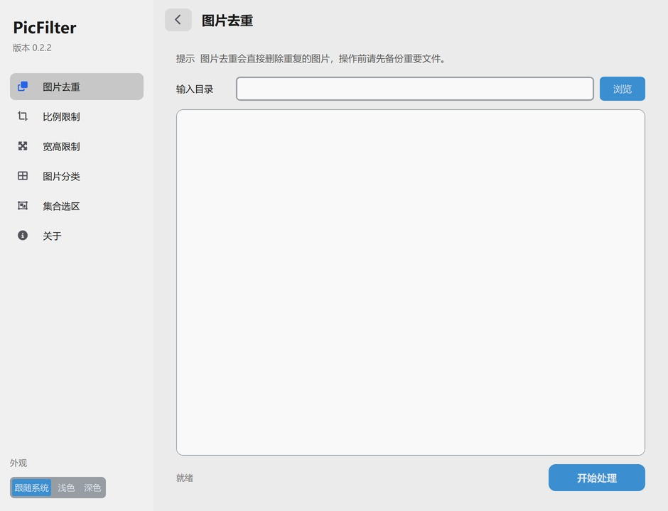

PicFilter是一个简单的图片处理程序，基于Pillow的实现，适用于批处理大量图片的筛选

# 功能
* 图片去重
* 宽高比筛选
* 宽高值筛选
* 分类为横/竖/方形图片
* 两图片组之间的集合选取对比


# 界面
使用 CustomTkinter 构建



# 使用注意
* 图片去重暂不支持不同大小的相同图片的判断
* 通过筛选的图片会复制到符合的图片目录中
* 图片筛选后的源文件不会删除（图片去重除外）

# 构建与发布

```bash
pip install -r requirements.txt
python App.py
```

版本号统一保存在 `package.json` 中，程序启动时会读取该文件。

推送 `v<major>.<minor>.<patch>` 格式的 tag 会触发 GitHub Actions：同步版本号、使用 PyInstaller 打包 Windows 版本，并根据上一个 tag 到当前 tag 之间的提交生成更新说明，自动发布到 GitHub Releases。

```bash
git tag v0.2.3
git push origin v0.2.3
```

